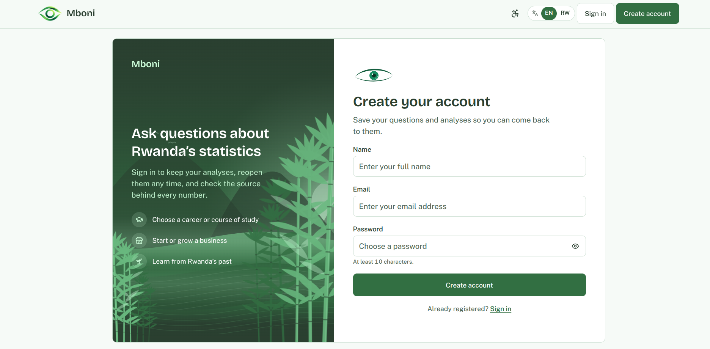
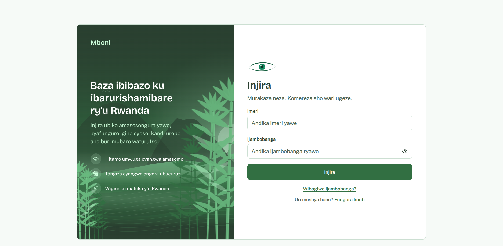
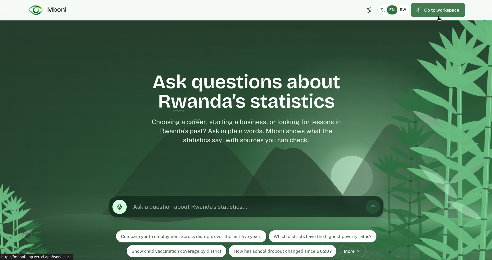
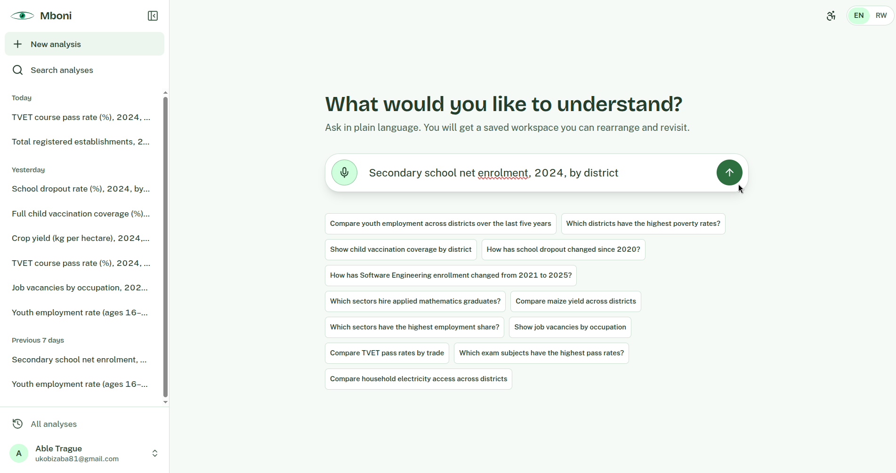
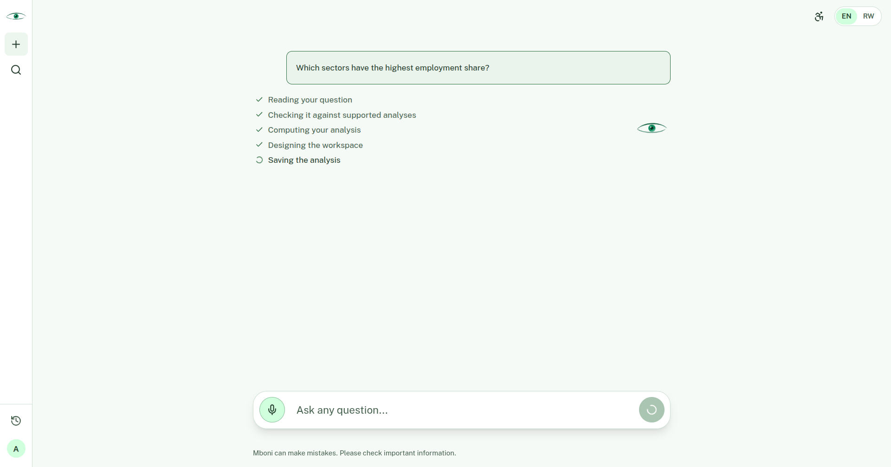
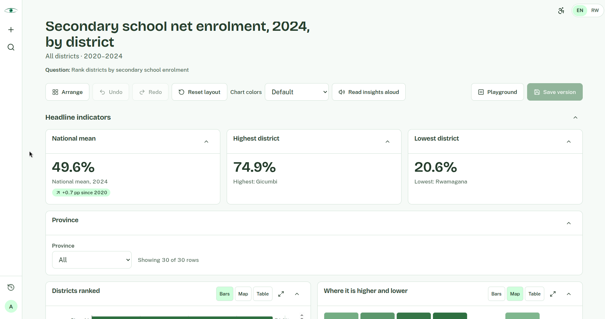
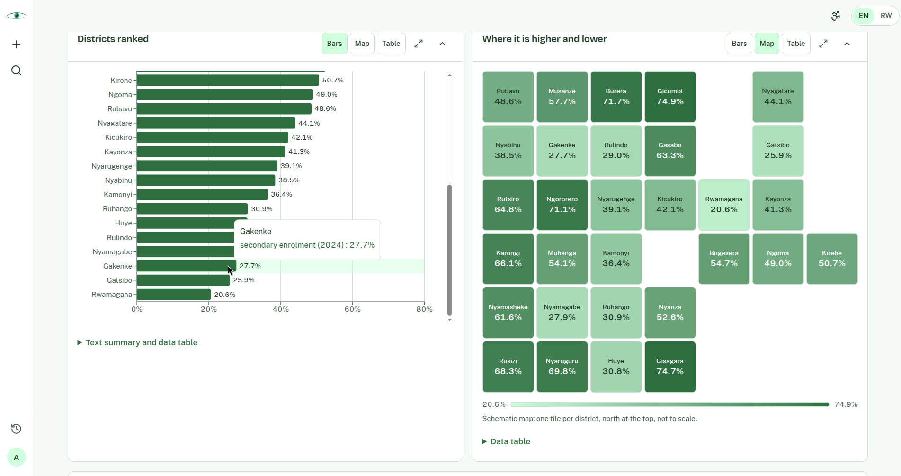
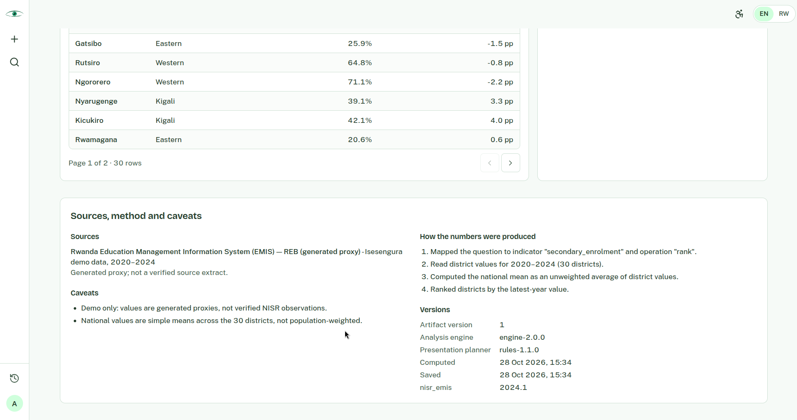
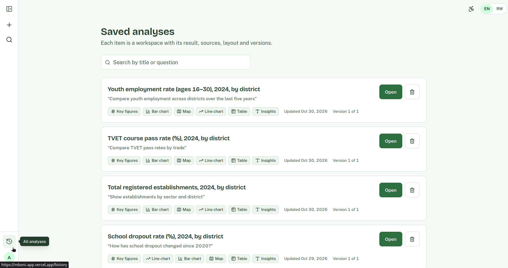

# Mboni

**Explore Rwanda's data. Understand what is changing. Make better-informed decisions.**

Mboni is a question-led analytical workspace for exploring Rwanda's public statistics. It turns supported questions into inspectable results—indicators, comparisons, visualizations, tables, and explanations—so people can better understand evidence relevant to decisions in agriculture, work, education, and other development areas.

Built by **Team Igisubizo** for the **2026 National Institute of Statistics of Rwanda (NISR) Big Data Hackathon**.

> **Live application:** https://mboni-app.vercel.app
>
> **Data status:** The current demo directly uses one official NISR crop-yield table. Most other topic areas run on generated proxy data and are demonstrations of the analysis workflow, not verified official findings.

---

## Contents

- [Project at a glance](#project-at-a-glance)
- [The problem](#the-problem)
- [Our approach](#our-approach)
- [Innovation and national development alignment](#innovation-and-national-development-alignment)
- [Who Mboni is designed to help](#who-mboni-is-designed-to-help)
- [What users can explore](#what-users-can-explore)
- [How to use Mboni](#how-to-use-mboni)
- [Screenshots](#screenshots)
- [Dataset inventory](#dataset-inventory)
- [Hackathon submission checklist](#hackathon-submission-checklist)
- [Analytical methodology](#analytical-methodology)
- [Responsible use of AI and statistics](#responsible-use-of-ai-and-statistics)
- [Architecture](#architecture)
- [Technology stack](#technology-stack)
- [Run locally](#run-mboni-locally)
- [Repository structure](#repository-structure)
- [Reproducibility and data files](#reproducibility-and-data-files)
- [Team](#team-and-contributions)

---

## Project at a glance

| Item                         | Details                                                                |
| ---------------------------- | ---------------------------------------------------------------------- |
| Project                      | Mboni                                                                  |
| Team                         | Igisubizo                                                              |
| Competition                  | 2026 NISR Big Data Hackathon                                           |
| Project type                 | Interactive data exploration and analytical decision-support workspace |
| Primary context              | Rwanda's public statistics and development data                        |
| Frontend                     | Next.js and TypeScript                                                 |
| Backend API                  | Node.js and TypeScript                                                 |
| Analytical/model service     | Python                                                                 |
| Database                     | PostgreSQL                                                             |
| Cache / queue infrastructure | Redis                                                                  |
| Local orchestration          | Docker Compose and pnpm                                                |
| Live application             | https://mboni-app.vercel.app                                           |

### What Mboni does

Mboni makes statistical evidence more approachable to people who may not have the time, technical background, or specialist tools required to work directly with datasets and statistical publications.

A user starts with a question. Where the question is supported by the data and analytical capabilities in the application, Mboni presents a structured result that can include:

- Key indicators and summary metrics.
- Charts selected to suit the type of result.
- Tables that allow users to inspect values.
- Comparisons across supported categories, places, or periods.
- Explanatory text that helps users interpret the result.
- Source information and limitations.

## The problem

Rwanda publishes a wide range of statistics that can inform national development and everyday decisions. The [NISR Microdata Catalog](https://microdata.statistics.gov.rw/index.php/catalog), for example, lists studies covering agriculture, labour, health, households, and other subjects. But published datasets are not automatically easy to use: they may be in separate files and formats, cover different years and populations, and require statistical knowledge to prepare, compare, and interpret.

A farmer or cooperative may want to compare reported crop yields by district and season. A student may want to understand employment patterns. A planner or researcher may need to compare indicators, locate gaps, and explain what the evidence can support.

The challenge is the gap between available data and usable evidence: **people need relevant statistics to be discoverable, understandable, comparable, and presented with enough context to assess.**

Mboni addresses this usability challenge by bringing question-led exploration, analysis, visual communication, and source-aware explanations into one workspace. It does not replace NISR, domain experts, or field research, and it does not make decisions on a user's behalf.

### The problem we are addressing

1. **Discoverability:** Relevant information can be spread across datasets, portals, reports, and publications.
2. **Interpretability:** Raw tables and statistical files can be difficult to interpret without analytical experience.
3. **Comparison:** Understanding change over time or differences between groups often requires additional data preparation.
4. **Decision context:** A statistic is more useful when users can understand its definition, period, coverage, and limitations.
5. **Accessibility:** Statistical information should be communicated in forms that are easier for different users to inspect and understand.

Mboni is a decision-support tool, not an official statistics producer. It aims to improve access to evidence, not replace the institutions responsible for producing official statistics or the experts responsible for interpreting them.

## Our approach

Mboni combines a conversational entry point with a structured analytical workspace.

Instead of treating a response as only a block of generated text, the application presents analytical findings as inspectable outputs. Users can see the result, understand how it is being communicated, and examine available values and source context.

## Innovation and national development alignment

### What is innovative about Mboni

Mboni's innovation is the way it connects a plain-language question to an inspectable analytical result. Rather than offering only a static dashboard or a free-form chatbot answer, it aims to help users move through a data-to-evidence workflow:

- **Ask a practical question:** Start with a question about a supported topic, place, category, or period.
- **Analyze available evidence:** Route the question to the relevant data and analytical method supported by the application.
- **Inspect the result:** Explore indicators, comparisons, charts, tables, and explanations in a persistent workspace.
- **Check the basis:** Review source information and limitations, and distinguish observed data from calculations, estimates, or generated demo data.

The same workspace is designed to accommodate questions across development domains, including agriculture, employment, education, household welfare, and business activity. That breadth describes the product direction—not a claim that every domain is already connected to verified official data.

### Relevance to Rwanda's development priorities

Mboni is intended to support the use of evidence in areas relevant to Rwanda's long-term [Vision 2050](https://www.minecofin.gov.rw/fileadmin/user_upload/Minecofin/Publications/REPORTS/National_Development_Planning_and_Research/Vision_2050/English-Vision_2050_full_version_WEB_Final.pdf) and the [National Strategy for Transformation 2 (NST2, 2024–2029)](https://www.minecofin.gov.rw/fileadmin/user_upload/Minecofin/Publications/STRATEGIES/NST_2/NST2_2024-2029_Abridged.pdf). These national frameworks establish long-term and medium-term development priorities; Mboni contributes a practical way to explore statistics relevant to those priorities.

| Development area                          | How Mboni can contribute                                                                                                          | Current demonstration                                                                                                                           |
| ----------------------------------------- | --------------------------------------------------------------------------------------------------------------------------------- | ----------------------------------------------------------------------------------------------------------------------------------------------- |
| Agricultural productivity and livelihoods | Make reported crop outcomes easier to compare across crops, districts, and seasons.                                               | A retrieved NISR crop-yield table is integrated. It has no reference year, so it cannot support year-over-year claims or a crop recommendation. |
| Productive work and skills                | Help users explore labour, education, training, and sector indicators together where sources and definitions allow.               | These areas are currently demonstrated mainly with generated proxy data; they are not verified labour-market findings.                          |
| Poverty reduction and financial inclusion | Make relevant household, financial-access, and geographic indicators easier to inspect when suitable official data is integrated. | Poverty proxies demonstrate analysis workflows; no verified financial-inclusion dataset is integrated, and no impact has been measured.         |

This is an alignment of purpose, not a claim that Mboni has achieved national targets or caused development outcomes. Any policy or personal decision should be based on verified, appropriately interpreted evidence and additional context.

### From question to evidence

1. **Ask:** The user enters a question related to a supported topic or dataset.
2. **Understand:** The system identifies the analytical intent and relevant available data.
3. **Analyze:** The analytical services process the available data using supported methods.
4. **Structure:** The result is organized into a validated presentation specification.
5. **Visualize:** The application renders appropriate indicators, charts, tables, and explanations.
6. **Inspect:** The user reviews values, comparisons, source information, and caveats.

The analytical result and its visual presentation are separate concerns. Changing how a result is displayed does not change the underlying analytical values.

### Why this approach matters

A chart can make a trend easier to see, but it must not obscure the underlying values. A generated explanation can make a result easier to understand, but it must not be treated as a substitute for the data. Mboni therefore emphasizes structured outputs, validation, and source-aware interpretation.

## Who Mboni is designed to help

Mboni is intended to serve people who need to understand Rwanda through evidence, including users who are not professional data analysts.

### Students and career explorers

Students and people exploring career options can use historical and current datasets to investigate changes in employment, education, economic activity, and other indicators.

Example questions:

- How have employment-related indicators changed over the available years?
- Which sectors have shown growth or decline in the available data?
- How do education-related indicators differ across groups or locations?
- What does the available evidence suggest about changes in the labour market?

These analyses help users ask better questions and identify areas for further research. Historical trends do **not** guarantee future job demand, individual employment outcomes, or the suitability of a particular career.

### Farmers and agricultural cooperatives

Users can explore the integrated NISR crop-yield table by crop, district, and season. Because the table does not provide a reference year, it cannot show year-over-year change. Yield comparisons alone are not planting recommendations: decisions also depend on current weather, soils, inputs, prices, market access, and local expertise.

### Entrepreneurs and business researchers

People considering a business idea can use public indicators to understand the context in which they plan to operate.

Example questions:

- How do population characteristics differ across districts?
- What changes are visible in relevant economic or household indicators?
- Which regions differ on a selected indicator?
- What public evidence is available about a sector or market-related condition?

Mboni helps users investigate context. It does not replace market research, customer validation, financial planning, regulatory checks, or professional business advice.

### Researchers, policymakers, and the public

Researchers can explore indicators, compare values, inspect trends, and identify questions for deeper statistical investigation. Policymakers and development practitioners can use relevant evidence to understand patterns and identify where further investigation is useful. Members of the public can use Mboni to approach official statistics more easily.

## What users can explore

| Area                                   | Example questions                                                           | Current evidence status                                                                     |
| -------------------------------------- | --------------------------------------------------------------------------- | ------------------------------------------------------------------------------------------- |
| Agriculture                            | How does the reported yield for a crop differ between districts or seasons? | Official NISR crop-yield table is integrated; the source does not provide a reference year. |
| Employment and labour                  | How have employment indicators changed over time?                           | Generated proxy data in the current demo; not verified NISR observations.                   |
| Education and training                 | How do education or training indicators differ across groups or years?      | Generated proxy data in the current demo; not verified source extracts.                     |
| Poverty, health, and household welfare | How do selected indicators compare across areas?                            | Generated proxy data in the current demo; not verified official findings.                   |
| Business and economic activity         | What patterns appear across sectors or districts?                           | Generated proxy data in the current demo; not verified official findings.                   |
| Financial inclusion                    | How does access to financial services vary across groups or areas?          | No verified financial-inclusion dataset is currently integrated.                            |

These are areas the application can route or demonstrate, not a promise that every question can be answered from official data. Users should check the source, period, geographic coverage, and definitions shown for each result.

## How to use Mboni

**Open the deployed application:** https://mboni-app.vercel.app

1. Open the web application, then log in or create an account.
2. Start with a question on a supported topic.
3. Submit the question and allow the analysis to complete.
4. Inspect the indicators, charts, tables, and explanation returned.
5. Review the source details, time period, geographic coverage, and caveats.
6. Try another question or comparison.

## Try the app

Open https://mboni-app.vercel.app and create your own account. Evaluators who need a shared demo account should request access credentials directly from the team; passwords are not published in this repository.

## Screenshots

### 1. Create an account



### 2. Sign in



### 3. Main workspace



### 4. Question and conversation



### 5. Analytical dashboard



### 6. Inspecting data



### 7. Geographic analysis



### 8. Final conclusion



### 9. Analysis history



## Dataset inventory

The [NISR Microdata Catalog](https://microdata.statistics.gov.rw/index.php/catalog) contains many studies that may support future analyses. A catalog listing is not the same as a dataset being downloaded, validated, or integrated into Mboni. The current repository contains one integrated official NISR table and generated proxy CSVs for developing and demonstrating other analysis paths.

### Official data integrated

| Dataset                                                  | What it contains                                                                                                | Source and local files                                                                                                                                                                                                                                                                                                                                                   |
| -------------------------------------------------------- | --------------------------------------------------------------------------------------------------------------- | ------------------------------------------------------------------------------------------------------------------------------------------------------------------------------------------------------------------------------------------------------------------------------------------------------------------------------------------------------------------------ |
| Average yield (kg/ha) by season, district, and crop type | Reported crop yield for the listed districts, crops, and Season A/B. The table does not state a reference year. | [NISR PxWeb table](https://pxweb.statistics.gov.rw/pxweb/en/NISR%20Statistical%20Databases/Agriculture/Crop%20area,%20production%20and%20yield%20for%20major%20crops/yield.px); [raw export](model/data/official/nisr_agriculture_yield_raw.csv); [normalized data](model/data/official/district_crop_yield.csv); [provenance metadata](model/data/official/source.json) |

### Generated proxy data used for demonstrations

The following files are generated examples. Their names and columns are shaped around subject areas, but their values are **not verified extracts of NISR or other official datasets**.

| Topic                         | Local file                                                                 |
| ----------------------------- | -------------------------------------------------------------------------- |
| Labour                        | [district_labour.csv](model/data/real/district_labour.csv)                 |
| Poverty and household welfare | [district_poverty.csv](model/data/real/district_poverty.csv)               |
| Health                        | [district_health.csv](model/data/real/district_health.csv)                 |
| Agriculture (demo proxy)      | [district_agriculture.csv](model/data/real/district_agriculture.csv)       |
| Education                     | [district_education.csv](model/data/real/district_education.csv)           |
| Business establishments       | [district_establishments.csv](model/data/real/district_establishments.csv) |
| Sector employment             | [sector_employment.csv](model/data/real/sector_employment.csv)             |
| TVET                          | [tvet_courses.csv](model/data/real/tvet_courses.csv)                       |
| Higher education              | [higher_ed_programs.csv](model/data/real/higher_ed_programs.csv)           |
| National exams                | [national_exams.csv](model/data/real/national_exams.csv)                   |
| Career demand                 | [career_demand.csv](model/data/real/career_demand.csv)                     |

The `model/data/real/` directory name is historical and does not mean these files contain real official observations. Regenerate the proxies with `python3 model/generate_real.py`. Replace them with source data only after obtaining, checking, documenting, and integrating the actual files.

## Hackathon submission checklist

The [NISR submission webinar](<docs/2026 NISR Hackathon Webinar 2.pdf>) asks teams to provide a README explaining the data used, what the application communicates, and how users interact with it. This README documents those points above. The webinar also asks for working project code, the data or a link to it, a demonstration video of no more than three minutes, and documents confirming team eligibility.

| Submission item                                       | Repository status                                                                                                                                                                         |
| ----------------------------------------------------- | ----------------------------------------------------------------------------------------------------------------------------------------------------------------------------------------- |
| README describing data, purpose, and user interaction | Included                                                                                                                                                                                  |
| Application and analysis source code                  | Included                                                                                                                                                                                  |
| Data and source links                                 | Official crop-yield files and provenance are included; proxy data is labelled separately above.                                                                                           |
| Short demonstration video (maximum three minutes)     | Not included in the repository yet.                                                                                                                                                       |
| Working sample login for evaluators                   | Request shared demo access from the team; credentials are not published in the repository. |
| Eligibility documents                                 | Not included in the repository. The webinar lists these as a submission item; confirm the accepted handling with the organizers before placing personal documents in a public repository. |

## Analytical methodology

Mboni aims to make analytical results easier to inspect, not simply to generate plausible-sounding text. Reliability depends on the quality of the input data, the appropriateness of the method, and the validity of the interpretation.

### Analytical workflow

1. **Question and intent:** Identify what the user is asking and the type of analysis required.
2. **Dataset selection:** Identify relevant datasets and fields that are available.
3. **Data preparation:** Apply the required cleaning, filtering, aggregation, and transformations.
4. **Analysis:** Calculate indicators or apply the relevant analytical method.
5. **Result validation:** Check the analytical result and its structure.
6. **Presentation planning:** Select suitable visual components for the result.
7. **Rendering:** Display the result with explanations and source context.

### Choosing a visualization

| Result type                            | Suitable presentation                   | What it helps users inspect          |
| -------------------------------------- | --------------------------------------- | ------------------------------------ |
| Single value or summary indicator      | Metric / KPI                            | A key value and its context          |
| Comparison across categories           | Bar chart or table                      | Relative differences                 |
| Change over time                       | Line or area chart                      | Direction and pattern over time      |
| Relationship between numeric variables | Scatter plot                            | Association and distribution         |
| Exact values or detailed records       | Table                                   | Values that should be read precisely |
| Geographic comparison                  | Map, when valid geographic fields exist | Spatial differences                  |
| Derived indicator                      | Formula and explanation                 | How a value was calculated           |

### Presentation validation

The presentation layer does not invent statistical values. It references values from the analytical result and uses supported component types. Each presentation specification is validated against the available result structure before rendering.

## Responsible use of AI and statistics

Mboni uses AI-assisted interaction and structured analytical presentation. AI-generated language must not be confused with official statistical publication or independently verified evidence.

### Historical data and future-oriented questions

Historical data helps users understand what has changed and identify patterns worth investigating. However, historical patterns do not automatically predict the future. Labour-market conditions, for example, are affected by policy, investment, technology, education, demographics, global conditions, and other factors. Any future-oriented result should be read with its assumptions, method, uncertainty, and limitations in mind.

### Decision support, not automated decision-making

Mboni supports informed exploration. It should not be treated as the sole basis for decisions about employment, investment, credit, public policy, business viability, or individual welfare.

## Architecture

Mboni is a multi-service application with a web client, an API, and an analytical/model service.

### Main components

| Component                | Responsibility                                                                                            |
| ------------------------ | --------------------------------------------------------------------------------------------------------- |
| Web application          | User interface, question entry, and presentation of analytical workspaces                                 |
| API                      | Application endpoints and coordination between the web application, data services, and analytical service |
| Analytical/model service | Python-based analytical and model functionality                                                           |
| PostgreSQL               | Persistent relational data storage                                                                        |
| Redis                    | Cache and queue infrastructure                                                                            |
| Docker Compose           | Local orchestration of development services                                                               |

### High-level request flow

```text
User
  |
  v
Next.js web application
  |
  v
Node.js / TypeScript API
  |
  +----------------------+
  |                      |
  v                      v
PostgreSQL              Redis
  |
  +--------------------------> Python analytical/model service
                                      |
                                      v
                              Analytical result
                                      |
                                      v
                              Validated presentation
                                      |
                                      v
                              Interactive workspace
```

### Presentation planner

The presentation-planning layer organizes an analytical result into supported visual components. It has a deterministic rules-based planning path and an optional language-model-assisted path when the relevant configuration is present.

The rules-based planner is the fallback when the optional LLM planner is unavailable or cannot produce a valid specification. The planner is a presentation component, not the statistical engine that produces the underlying analysis.

The final presentation specification is validated before rendering. This keeps the user interface within the supported component catalog and ties displayed values to the analytical result.

## Technology stack

| Layer                        | Technology             | Role                                            |
| ---------------------------- | ---------------------- | ----------------------------------------------- |
| Web application              | Next.js                | Web application framework                       |
| Frontend language            | TypeScript             | Typed application development                   |
| API                          | Node.js and TypeScript | Backend application services                    |
| Analytical service           | Python                 | Data and analytical/model functionality         |
| Database                     | PostgreSQL             | Relational persistence                          |
| Cache / queue infrastructure | Redis                  | Supporting infrastructure                       |
| Development orchestration    | Docker Compose         | Local multi-service environment                 |
| Package manager              | pnpm                   | Root development scripts and package management |

## Run Mboni locally

The repository includes a Docker Compose development setup. Root scripts:

| Command              | Purpose                                    |
| -------------------- | ------------------------------------------ |
| `pnpm run dev`       | Start the development Docker Compose stack |
| `pnpm run dev:build` | Build service images and start the stack   |
| `pnpm run dev:logs`  | Follow development service logs            |
| `pnpm run dev:down`  | Stop the development stack                 |

### Prerequisites

Install:

- [Git](https://git-scm.com/)
- [Docker Desktop](https://www.docker.com/products/docker-desktop/) or Docker Engine with the Docker Compose plugin
- [Node.js](https://nodejs.org/)
- [pnpm](https://pnpm.io/)

### 1. Clone the repository

```bash
git clone https://github.com/AimableUK/IGISUBIZO_NISR_ML
cd IGISUBIZO_NISR_ML
```

### 2. Configure environment variables

The API service loads a root `.env` file. Copy the template and fill in the required values:

```bash
cp .env.example .env
```

The Compose configuration supplies the PostgreSQL and Redis connection values. The web service reaches the API at `http://localhost:4000`.

### 3. Build and start the services

```bash
pnpm run dev:build
```

Or start the stack without rebuilding:

```bash
pnpm run dev
```

### 4. Open the local services

| Service                  | Local address         |
| ------------------------ | --------------------- |
| Web application          | http://localhost:3000 |
| API                      | http://localhost:4000 |
| Analytical/model service | http://localhost:8000 |

The API depends on PostgreSQL, Redis, and the model service. The first startup may take longer while Docker builds images and installs dependencies.

### 5. View logs

```bash
pnpm run dev:logs
```

### 6. Stop the development stack

```bash
pnpm run dev:down
```

The PostgreSQL data is kept in a named Docker volume, so stopping the services does not delete the database.

### Troubleshooting

| Problem                                  | What to check                                                                           |
| ---------------------------------------- | --------------------------------------------------------------------------------------- |
| Docker reports that `.env` is missing    | Create the root `.env` and populate the variables required by the API                   |
| A port is already in use                 | Check ports `3000`, `4000`, `5432`, `6379`, and `8000`                                  |
| A service fails during startup           | Run `pnpm run dev:logs` and inspect the failing service                                 |
| Web application loads but analysis fails | Inspect API and model service logs and verify their configured URLs                     |
| Changes are not reflected                | Rebuild the relevant image with `pnpm run dev:build`                                    |
| Database connection fails                | Confirm PostgreSQL is healthy and the API connection string matches the Compose service |

## Repository structure

```text
IGISUBIZO_NISR_ML/
├── web/                    # Next.js web application
├── api/                    # Node.js / TypeScript API
├── model/                  # Python analytical/model service
│   └── data/
│       ├── official/       # NISR crop-yield export, normalized data, provenance
│       └── real/           # Generated proxy CSVs (legacy directory name)
├── docs/
│   └── screenshots/        # README screenshots
├── docker-compose.yml      # Local development services
├── package.json            # Root development scripts
├── pnpm-lock.yaml          # Root package lockfile
├── .env.example            # Environment variable template
└── README.md               # Project documentation
```

## Reproducibility and data files

The [dataset inventory](#dataset-inventory) separates the official NISR crop-yield table from generated proxy CSVs. The official raw export, normalized file, and provenance metadata are checked in under [`model/data/official/`](model/data/official/). The generated examples are under [`model/data/real/`](model/data/real/) despite that directory's legacy name; they are not official observations. For additional NISR datasets, consult the [NISR Microdata Catalog](https://microdata.statistics.gov.rw/index.php/catalog), then record each dataset's exact source, access conditions, definitions, period, and processing steps before describing it as integrated.

## Team and contributions

**Team name:** Igisubizo

| Team member       | Contribution                                                               | GitHub                                         |
| ----------------- | -------------------------------------------------------------------------- | ---------------------------------------------- |
| Aimable Ukobizaba | Full-stack application development and system integration/Analytical/model | [@AimableUK](https://github.com/AimableUK)     |
| EnockHumure       | Full-stack application development and system integration/Analytical/model | [@EnockHumure](https://github.com/EnockHumure) |

### AI assistance disclosure

> AI tools were used to assist with selected aspects of project planning, software development, documentation, and analytical-method exploration. The team reviewed the resulting work and remains responsible for the implementation, data sources, analytical methods, validation, and findings presented in this submission.

---

<p align="center">
  <strong>Mboni</strong><br />
  Explore Rwanda's data. Understand what is changing. Make better-informed decisions.<br />
  <strong>Team Igisubizo | NISR Big Data Hackathon 2026</strong>
</p>
